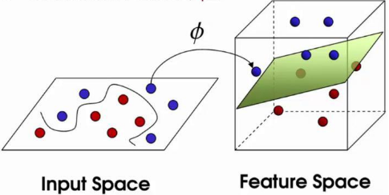
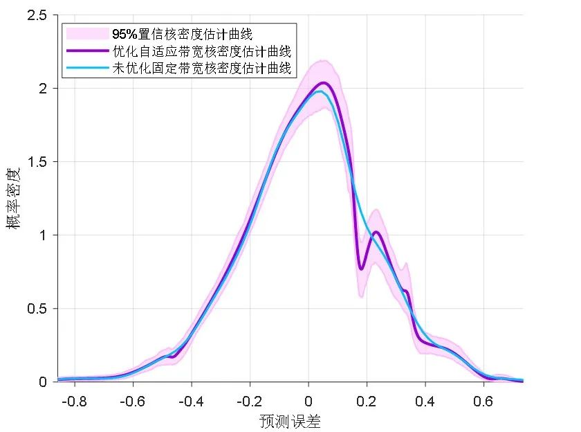
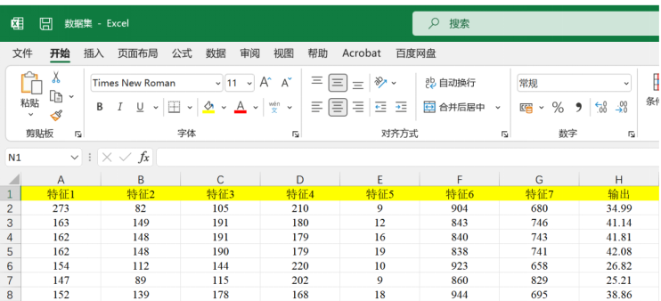
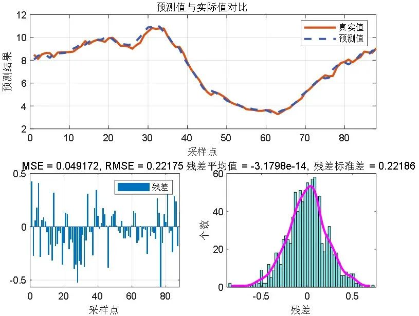
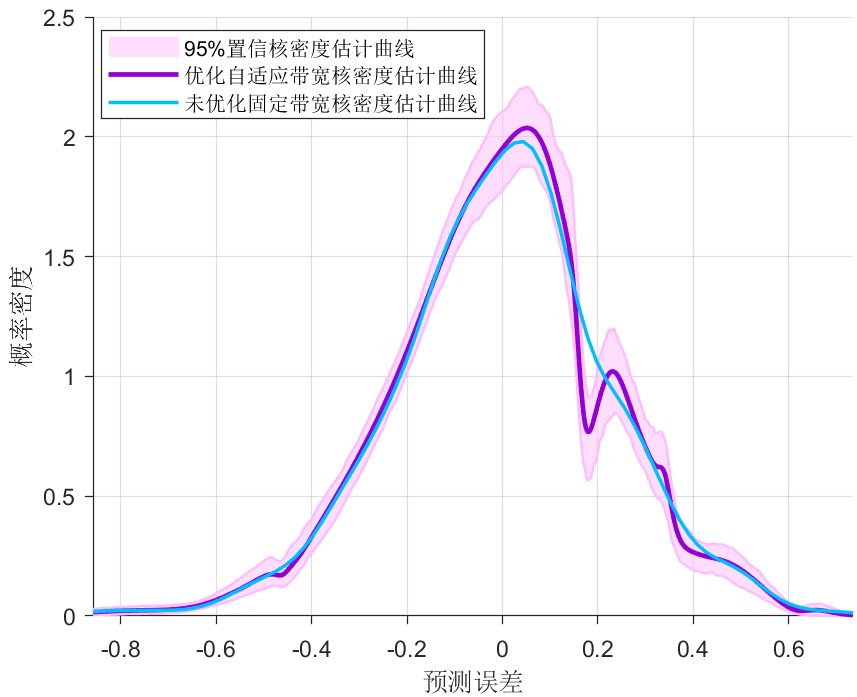
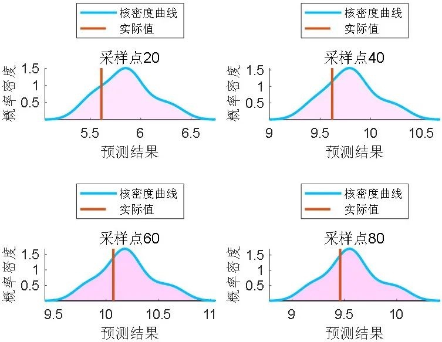
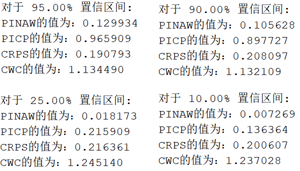
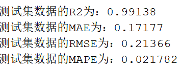

# A program learns three prediction methods! Multivariate regression prediction + interval prediction + kernel density estimation, LSSVM-ABKDE's multivariate regression prediction program

Applicable Platform: Matlab2022 and above
Traditional regression prediction fails to effectively capture the uncertainty of fluctuations in new energy sources, making it difficult to gain approval from review experts. Interpolation prediction can provide richer uncertain information, significantly enhancing the value of photovoltaic and wind power forecasting in practical applications. Currently, there is a limited amount of literature on interpolation prediction + probability density estimation, with high-level journals being published. Therefore, interpolation prediction + probability density estimation can be considered as a major innovation point for various research directions.
LSSVM (Least Squares Support Vector Machine) has three main innovations compared to traditional machine learning methods:
Simplified optimization problem: LSSVM simplifies the quadratic programming problem of traditional SVM into solving linear equations, which greatly improves computational efficiency, especially when dealing with large-scale datasets.
Square error loss function: LSSVM uses the square error loss function instead of the hinge loss function of traditional SVM, providing stronger robustness against outliers and simplifying the mathematical processing process of the model.
Equation constraints: The optimization problem in LSSVM adopts equation constraints instead of inequality constraints, which makes the problem solution more direct and stable, while reducing the complexity of model training.
Adaptive bandwidth kernel density estimation (ABKDE) has three innovations compared to traditional kernel density estimation methods:
Dynamic bandwidth adjustment: Adaptive bandwidth kernel density estimation assigns different bandwidths to each data point, adjusting them according to local density characteristics around the data points, improving the local adaptability and precision of the estimation.
Improved data adaptability: By adjusting the bandwidth size to adapt to the local features of the data, this method can effectively handle data with complex or multimodal distributions, avoiding oversmoothing or overfitting issues caused by fixed bandwidth in traditional methods.
Optimized performance indicators: Adaptive bandwidth kernel density estimation often combines cross-validation techniques to optimize bandwidth selection, improving the overall performance of density estimation, especially in statistical inference and probability analysis applications.
This figure shows the possible range of errors for the ABKDE method and the most likely error value, indicating that the ABKDE method can provide more accurate probability density estimation results!
Data format:
Imported directly from Excel, very convenient! The first 1-7 columns are input features, and the last column is the output value. No programming knowledge is required to run by replacing data.
Program results:
Prediction vs. actual values comparison and errors:
Kernel density estimation curve graph:
Probability density estimation curve graph:
The curve fitting degree between predicted values and actual values is very high. For interval prediction, the following four evaluation indicators are provided:
PINAW (Predictive Interval Normalized Mean Width): PINAW is the average of the ratio of the width of the predictive interval to the range of actual data, used to measure the relative size of the predictive interval. The smaller the PINAW value, the tighter the predictive interval, usually indicating lower uncertainty in predictions.
PICP (Predictive Interval Coverage Probability): PICP is the proportion of actual values falling within the predictive interval, reflecting the reliability of the predictive interval. An ideal PICP should be close to the set confidence level (e.g., 95%), with too high or too low values indicating an unreasonable setting for the predictive interval.
CRPS (Continuous Ranking Probability Score): CRPS is an index for measuring the quality of probability predictions, comparing the distribution of predictions with actual observations. It combines both accuracy and reliability assessment, with a smaller value indicating higher accuracy in predictions.
CWC (Composite Width and Coverage Probability Score): CWC is an integrated evaluation index for the width and coverage probability of the predictive interval. By adjusting parameter eta, it allows for a trade-off between width and coverage probability. It provides a comprehensive performance metric for balancing the width and coverage probability of the predictive interval, helping to determine the optimal setting for the predictive interval.
Regression prediction evaluation indicators (MAPE, MAE, RMSE, R²):
Determinant coefficient R² reaches over 99%, indicating extremely high precision!

## Images

<!-- PAYMENT_BLOCK -->

## Get this dataset

- Payment link (Stripe): [Buy now](https://buy.stripe.com/3cs8yP7sY87d0vu9AB)
- Payment QR code: 

<!-- /PAYMENT_BLOCK -->
